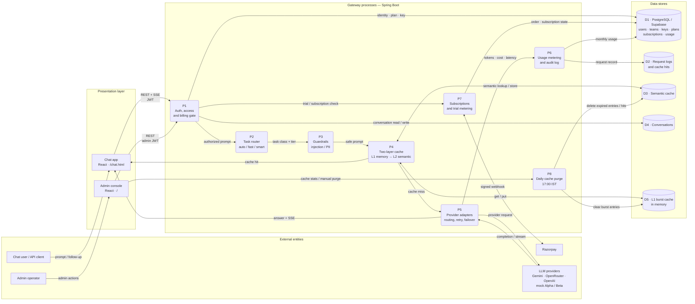

<div align="center">

# Prism

**An OpenAI-compatible LLM gateway with task-aware routing, provider failover, semantic caching, usage metering, billing, and a React control plane.**

[](https://openjdk.org/)
[](https://spring.io/projects/spring-boot)
[](https://react.dev/)
[](https://www.postgresql.org/)
[](https://www.docker.com/)
[](https://platform.openai.com/docs/api-reference)

[Quick start](#quick-start) · [Architecture](#architecture) · [API](#api-reference) · [Configuration](#configuration) · [Deploy](#build-and-deploy) · [Docs](#documentation)

</div>

---

Prism sits between your applications and one or more LLM providers. It exposes a single OpenAI-shaped API, then decides **which provider and model** should answer, applies **guardrails and caching**, and records **tokens, cost, and latency** for every request. A separate admin console manages keys, plans, teams, users, subscriptions, and live traffic.

The core demo runs entirely offline against the bundled mock providers, so you can explore every feature without an API key.

## Why Prism

| | Capability | What it gives you |
|---|---|---|
| 🔀 | **One API, many providers** | Gemini, OpenRouter, OpenAI, and local mocks behind `POST /v1/chat/completions` |
| 🧭 | **Task-aware routing** | `auto` classifies prompts into search, research, reasoning, code, or simple lookup |
| 🛟 | **Retries and failover** | Exponential backoff, retryable-error handling, and ordered provider fallback |
| 🎯 | **Per-key routing** | Each virtual key can prefer `auto`, `openrouter`, `gemini`, `openai`, or `mock` |
| ⚡ | **Two-layer cache** | Bounded in-memory burst cache in front of a durable semantic Postgres cache |
| 🛡️ | **Guardrails** | Prompt-injection and PII policies with `off`, `flag`, `block`, and `redact` modes |
| 🔐 | **Private by design** | Provider credentials stay server-side; chat surfaces hide model identity |
| 📊 | **Metering and logs** | Provider-reported tokens, cost, latency, cache/fallback outcome, and request audit |
| 💳 | **Access and billing** | Plans, teams, virtual keys, 5-request trials, and Razorpay subscriptions |
| 🖥️ | **Operations console** | React admin UI plus a separate end-user chat app |

## Contents

- [Architecture](#architecture)
- [Quick start](#quick-start)
- [Demo keys](#demo-keys)
- [How it works](#how-it-works)
  - [Routing and failover](#routing-and-failover)
  - [Per-key routing profiles](#per-key-routing-profiles)
  - [Cache, metering, and logs](#cache-metering-and-logs)
  - [Guardrails](#guardrails)
  - [Privacy and model identity](#privacy-and-model-identity)
  - [Access control and billing](#access-control-and-billing)
  - [Password reset](#password-reset)
- [API reference](#api-reference)
- [Configuration](#configuration)
- [Build and deploy](#build-and-deploy)
- [Testing and verification](#testing-and-verification)
- [Project layout](#project-layout)
- [Documentation](#documentation)
- [Security notes](#security-notes)

## Architecture

Prism has four trust boundaries: the **browser**, the **Spring Boot gateway**, the **PostgreSQL data stores**, and **external services**. The gateway is the only component that holds provider credentials. The chat path receives privacy-safe status and answer events, while `/v1/chat/completions` remains transparent for API clients.



**Legend:** rectangle = external entity · rounded rectangle = process · cylinder = data store · arrow = data flow.

The backend lives in package `com.dhruva.airtribe.prism`. The original Python files and verification utilities remain in the repository, but the Prism application runs on the Spring Boot backend.

## Quick start

**Requirements:** Java 17+, Maven 3.9+, Node.js 20.19+ (or 22.12+), and Python 3.9+ for the mock providers and verification scripts.

Start the mock providers in two terminals from the project root:

```powershell
python scripts/mock_provider.py --port 9001 --name alpha
python scripts/mock_provider.py --port 9002 --name beta
```

Start Spring Boot in a third terminal:

```powershell
cd backend
mvn spring-boot:run
```

Start the admin console in a fourth terminal:

```powershell
cd frontend
npm install
npm run dev
```

| Service | URL |
|---|---|
| Admin console | http://localhost:5173 |
| Gateway API | http://localhost:8080 |
| Chat app | http://localhost:5174/chat.html (`npm run dev:chat`) |

`VITE_API_URL` points the console at a different gateway URL. `PRISM_DATA_DIR`, `PRISM_DB`, and `PORT` configure the seed directory, local SQLite file, and backend port.

In the console, open **Access** to create plans, teams, and chat users. A user receives a private virtual key from the selected team's plan; the key is shown only once, when it is created. Chat users sign in at the chat app with the username or email and password set by the administrator. Their key never leaves the server.

> **No API key required.** The default demo uses the bundled Alpha/Beta mock providers. Add `OPENROUTER_API_KEY` or `GEMINI_API_KEY` when you want live models.

## Demo keys

| Team | Key | Models | Requests/min | Monthly budget |
|---|---|---|---:|---:|
| search | `prism-sk-search-1a2b3c` | fast, auto | 60 | $50 |
| research | `prism-sk-research-4d5e6f` | fast, smart, auto | 300 | $500 |
| free-tier | `prism-sk-free-7g8h9i` | fast, auto | 10 | $5 |
| budget-demo | `prism-sk-budget-demo-0j1k2l` | fast, auto | 60 | $0.00001 |

Keys, aliases, prices, and provider endpoints load from the supplied files under `data/`. Seed values are preserved for the demo scripts.

## How it works

### Routing and failover

`fast` and `smart` map to a configured primary model and an ordered fallback list. Prism retries the primary up to three times for retryable errors (timeouts, `429`, and `5xx`) with exponential backoff from `gateway_config.sample.json`, then advances to the next provider. Responses identify the serving provider and set `x-prism-fallback` when a fallback served the request.

For `model: "auto"`, a deterministic task router runs before model resolution. It classifies the prompt into **web search**, **research**, **reasoning / chain of thought**, **code**, or **simple lookup** using weighted lexical signals — proofs, estimation, distributed-systems, citations, algorithms, freshness, extraction, lookups, and rewrites — rather than prompt length alone.

- Research, reasoning, and code use the **smart** tier.
- Web search and simple lookups use the **fast** tier.
- The task, tier, confidence, and matched reason appear in the request log, the `x-prism-task` response header, and the Playground.
- The router reads the prompt, never the evaluation labels.
- On the 20-case eval it scores **20/20**, while the best length-only baseline scores **15/20** at a 42-character threshold.

When OpenRouter is primary, `auto` also picks a task-specific upstream model: `OPENROUTER_MODEL` for search/simple (optionally `:online`), `OPENROUTER_MODEL_RESEARCH`, `OPENROUTER_MODEL_REASONING`, and `OPENROUTER_MODEL_CODE`. The task route is followed by the generic OpenRouter tier and then the mocks, so failover still applies. With mocks as primary, the alias order is unchanged.

Run the routing report while the gateway is running:

```powershell
python scripts/eval_spring_router.py --url http://localhost:8080
```

### Per-key routing profiles

Every virtual key stores its own `routing_profile`:

| Profile | Behavior |
|---|---|
| `auto` | Use the gateway's global provider preference |
| `openrouter` | Nemotron / task-specific OpenRouter routes |
| `gemini` | Google Gemini first |
| `openai` | OpenAI first, when `OPENAI_API_KEY` is configured |
| `mock` | Local Alpha/Beta providers |

The profile applies to both `auto` classification and explicit `fast`/`smart` aliases, so two keys on the same gateway can resolve to different providers simultaneously. Fallback order remains: **key profile provider → other configured live providers → local mocks**.

Change a key's profile in **Virtual keys** or **Access**, or via:

```powershell
PATCH /admin/managed-keys/ref/{key_ref}
{ "routing_profile": "gemini" }
```

`GET /admin/routing/profiles` lists the profiles currently available. The seeded demo keys use OpenRouter, Gemini, and mock profiles to demonstrate the split.

### Cache, metering, and logs

- Cache lookups are two-layer and isolated by virtual key and requested alias. **L1** is a bounded in-process burst cache (500 entries, 15-minute TTL) that answers identical or close paraphrases without a database read. **L2** is the durable Postgres semantic cache, using normalized word overlap plus a small synonym map and inspecting the newest 500 matching entries.
- Successful upstream responses are cached; errors are not. Cache hits cost nothing. A Postgres hit is promoted into L1, so the next repeat is served from memory.
- L2 is capped on every write: **1,000 global rows**, **200 rows per key**, **5,000 hit-history rows**, **32 KB per response**, and **24-hour retention** by default. Rows older than the effective per-key TTL are deleted when that key writes again.
- A scheduled purge runs daily at **17:00 Asia/Kolkata**. It clears L1 and deletes all `cache_entries` and `cache_hits` rows. Admins can trigger the same purge with `POST /admin/cache/purge`.
- Provider-reported token usage drives cost calculation against `model_pricing.json`. Client-declared usage is ignored.
- Monthly spend is updated atomically with a database upsert. Per-key admission is serialized through completion and stream usage accounting, so one gateway records each request's final cost before admitting the next request for that key.
- RPM admission uses a synchronized in-process sliding window. It is race-safe for one gateway instance; it is not distributed across instances.
- Logs include request ID, team, model, status, provider, cache/fallback outcome, retries, token counts, cost, and latency. **Raw prompts, virtual keys, and provider credentials are never logged.**

### Guardrails

Input guardrails run before budget admission and before any upstream call. Each key inherits `guardrail_injection` and `guardrail_pii` from its plan:

| Mode | Behavior |
|---|---|
| `off` | Disabled |
| `flag` | Log a warning and continue |
| `block` | Return HTTP 400 `guardrail_blocked` |
| `redact` | Mask the matched text and continue |

Every user turn in the replayed conversation is inspected, so an injection hidden in earlier history is caught too.

- **Injection** covers phrases such as "ignore all previous instructions", "reveal your system prompt", and "override the system prompt".
- **PII** covers email, SSN, phone, payment-card numbers, and simple street addresses.
- A `flag` writes a `guardrail_flag` warning with the key ref, team, and rule — never the prompt text or virtual key.
- Rejections are recorded as `rejected_guardrail` in the request log.

### Privacy and model identity

Model-identity questions such as "which model do you use", "who created you", or "tell me all model-related details" are answered from Prism's routing metadata, not from the model's trained self-description.

| Surface | Behavior |
|---|---|
| **Public API** (`/v1/chat/completions`) | Injects an authoritative fact sheet naming the selected model, creator, family, variant, gateway, provider route, requested alias, tier, task, fallback chain, fallback usage, and pricing. Identity turns bypass the semantic cache. Metadata is also returned as `x-prism-model`, `x-prism-model-creator`, and `x-prism-model-family`. |
| **Chat** (`/app/chat`) | Injects a confidentiality instruction instead, bypasses the cache, rewrites streamed chunks with `model: "prism"`, redacts assistant text server-side before storage, and sets `x-prism-model-hidden: true` with no provider/model headers. |

Stored assistant turns are redacted again on read, so older conversations cannot leak metadata. The chat renderer masks any remaining identifiers and always shows **Served by · model details hidden**. This keeps the public API transparent for API and audit consumers while chat users — including anyone inspecting DevTools — see no upstream model, creator, tier, or fallback details.

### Access control and billing

- Admin endpoints require a valid `ADMIN` JWT. Public admin signup is **bootstrap-only**: open only while `auth_users` has no administrator, then closed permanently. The UI hides the signup tab when `GET /auth/bootstrap` reports `signup_open: false`.
- Chat signups use the separate self-serve `/app/signup` path and never create an administrator.
- Public chat accounts receive a **5-request demo**, then require **Pro (₹499/month)** or **Enterprise (₹1,999/month)** through Razorpay.
- Admin-provisioned and existing accounts are unlimited; only self-signups are metered.
- Plans configure monthly USD budget, RPM/TPM limits, token cap, model allowlist, cache similarity/TTL, guardrails, and optional verification models.
- A plan with checker models enables multi-model answer verification in chat.
- The Razorpay key secret stays server-side; only the public key id is returned to Checkout.

Set `RAZORPAY_PAY_KEY_ID`, `RAZORPAY_PAY_KEY_SECRET`, `RAZORPAY_MERCHANT_ID`, and `RAZORPAY_WEBHOOK_SECRET` in the root `.env`, and point the Razorpay Dashboard webhook at `/webhooks/razorpay` with the same secret.

### Password reset

Both sign-in screens (`/` for the console and `/chat.html` for chat) have a **Forgot password?** flow. Chat users need an email address, which the **Access** page collects when creating or editing a user.

Reset links are random, single-use, stored as SHA-256 hashes, and expire after 30 minutes. To send real email, set `PRISM_MAIL_HOST`, `PRISM_MAIL_PORT`, `PRISM_MAIL_USERNAME`, `PRISM_MAIL_PASSWORD`, and `PRISM_MAIL_FROM`. Gmail requires an app password.

When SMTP is not configured, the local gateway returns a development reset link instead of pretending to send mail. The enterprise profile disables that fallback with `PRISM_MAIL_EXPOSE_RESET_LINK=false`.

## API reference

### Public and auth

| Method | Path | Purpose |
|---|---|---|
| `POST` | `/v1/chat/completions` | OpenAI-shaped completions with `fast`, `smart`, `auto`, or a configured model; supports SSE streaming |
| `GET` | `/health` | Liveness and service name |
| `GET` | `/auth/bootstrap` | Reports whether first-admin signup is open |
| `POST` | `/auth/signup` | Bootstrap admin signup, or admin-authenticated account creation |
| `POST` | `/auth/signin` | Admin sign-in; returns a JWT |
| `POST` | `/auth/password/forgot` | Request an admin reset link |
| `POST` | `/auth/password/reset` | Consume a reset token and set a new password |

Every completion returns the full header contract: `x-prism-provider`, `x-prism-cache`, `x-prism-fallback`, `x-prism-cost-usd`, plus `x-prism-task` for `auto` requests. Streaming responses send `x-prism-cost-usd: 0.000000000` because headers are written before the stream completes; the final cost is recorded in usage and the request log.

If an upstream returns only reasoning deltas or an empty non-streaming answer, Prism treats it as a failed attempt and advances to the next provider instead of returning a blank answer. Reasoning models are asked to exclude hidden reasoning from the response.

### Admin

All routes below require `Authorization: Bearer <ADMIN JWT>`.

| Method | Path | Purpose |
|---|---|---|
| `GET` | `/admin/overview` | Product metrics summary |
| `GET` | `/admin/metrics` | Users, subscriptions, MRR, traffic |
| `GET` | `/admin/usage?key=` | Usage with server-side key filter |
| `GET` | `/admin/logs?limit=100&key=` | Request audit log |
| `GET` | `/admin/cache/stats` | Cache statistics |
| `GET` | `/admin/cache/entries?limit=200` | Durable cache entries |
| `GET` | `/admin/cache/hits?limit=200` | Cache hit history |
| `DELETE` | `/admin/cache/entries/{id}` | Delete one cache entry |
| `POST` | `/admin/cache/purge` | Clear L1 and both Postgres cache tables |
| `GET` | `/admin/keys` | Managed keys as `key_ref` + `key_hint` |
| `GET` | `/admin/providers/health` | Provider health |
| `GET` | `/admin/router/eval` | Router evaluation |
| `GET` | `/admin/routing/profiles` | Available routing profiles |
| `POST` | `/admin/playground/chat` | Admin-only stream with model details hidden |

### Managed access

| Method | Path | Purpose |
|---|---|---|
| `GET/POST/PATCH/DELETE` | `/admin/plans` | Plans and limits |
| `GET/POST/PATCH/DELETE` | `/admin/teams` | Teams and plan assignment |
| `GET/POST/PATCH/DELETE` | `/admin/users` | Chat users (DELETE disables account and key) |
| `POST` | `/admin/managed-keys/ref/{key_ref}/enable` | Enable a key |
| `POST` | `/admin/managed-keys/ref/{key_ref}/disable` | Disable a key immediately |
| `POST` | `/admin/managed-keys/ref/{key_ref}/rotate` | Rotate and return the new key once |
| `PATCH` | `/admin/managed-keys/ref/{key_ref}` | Change the key's routing profile |

Creating a user mints a `prism-sk-…` virtual key with `SecureRandom` and returns it **once** so the administrator can copy it. After that, admin reads return only `key_ref` and `key_hint`; the Playground and key-management actions use the opaque ref. Seeded demo keys are never regenerated, so the supplied demo scripts keep working.

### Chat

Chat endpoints use a chat-session JWT from `POST /app/login`.

| Method | Path | Purpose |
|---|---|---|
| `POST` | `/app/signup` | Self-serve chat account with 5-request demo |
| `POST` | `/app/login` | Chat sign-in |
| `GET` | `/app/me` | Current chat profile |
| `GET/POST` | `/app/conversations` | List or create conversations |
| `GET/PATCH/DELETE` | `/app/conversations/{id}` | Read, rename, or delete a conversation |
| `POST` | `/app/chat` | Privacy-scoped streaming chat |
| `GET` | `/app/usage` | Monthly usage and token cap |
| `POST` | `/app/password/forgot` | Request a chat reset link |
| `POST` | `/app/password/reset` | Consume a chat reset token |
| `GET` | `/app/billing/status` | Trial and subscription state |
| `POST` | `/app/billing/order` | Create a Razorpay order |
| `POST` | `/app/billing/verify` | Verify a Razorpay payment |
| `POST` | `/webhooks/razorpay` | Signed Razorpay webhook |

Conversation records are scoped to the signed-in user. API-only users cannot use chat endpoints.

## Configuration

Configuration is read from environment variables or the repo-root `.env`. The Spring Boot defaults are in `application.properties`; hosted PostgreSQL settings live in `application-enterprise.properties`.

### Core

| Variable | Default | Purpose |
|---|---|---|
| `PORT` | `8080` | Backend HTTP port |
| `SPRING_PROFILES_ACTIVE` | — | Set to `enterprise` for PostgreSQL + Flyway |
| `DATABASE_URL` | SQLite | JDBC URL; enterprise default `jdbc:postgresql://localhost:5432/prism` |
| `DATABASE_USERNAME` | `prism` | PostgreSQL user |
| `DATABASE_PASSWORD` | `prism` | PostgreSQL password |
| `DATABASE_POOL_MAX` | `20` | Hikari maximum pool size |
| `JWT_SECRET` | local dev value | Token signing secret — replace in production |
| `JWT_TTL_SECONDS` | `86400` | Token lifetime |
| `PRISM_DB` | `../prism-java.db` | SQLite file for local runs |
| `PRISM_DATA_DIR` | `../data` | Seed and pricing directory |
| `PRISM_CORS_ORIGINS` | localhost origins | Comma-separated allowed browser origins |
| `PRISM_ROUTING_STRATEGY` | `failover` | `failover`, `least_latency`, or `weighted` |

### Providers

| Variable | Default | Purpose |
|---|---|---|
| `OPENROUTER_API_KEY` | — | Enables OpenRouter |
| `OPENROUTER_PREFER_AS_PRIMARY` | `false` | Make OpenRouter primary |
| `OPENROUTER_MODEL` | `nvidia/nemotron-3.5-lightning:free` | Fast / simple / search route |
| `OPENROUTER_MODEL_RESEARCH` | `nvidia/nemotron-3-ultra-550b-a55b:free` | Research route |
| `OPENROUTER_MODEL_REASONING` | `nvidia/nemotron-3-nano-omni-30b-a3b-reasoning:free` | Reasoning route |
| `OPENROUTER_MODEL_CODE` | `cohere/north-mini-code:free` | Code route |
| `OPENROUTER_SEARCH_ONLINE` | `false` | Append `:online` to the search/simple model |
| `OPENROUTER_MAX_TOKENS` | `4096` | Completion token cap |
| `GEMINI_API_KEY` | — | Enables Gemini |
| `GEMINI_MODEL` | `gemini-3.1-flash-lite` | Gemini model |
| `GEMINI_PREFER_AS_PRIMARY` | `false` | Make Gemini primary |
| `OPENAI_API_KEY` | — | Enables OpenAI |
| `OPENAI_BASE_URL` | `https://api.openai.com/v1` | OpenAI-compatible endpoint |
| `OPENAI_MODEL` | `gpt-4o-mini` | OpenAI model |

### Cache and billing

| Variable | Default | Purpose |
|---|---|---|
| `PRISM_CACHE_MEMORY_MAX_ENTRIES` | `500` | L1 entry cap |
| `PRISM_CACHE_MEMORY_TTL_SECONDS` | `900` | L1 TTL |
| `PRISM_CACHE_MAX_ENTRIES` | `1000` | Global L2 row cap |
| `PRISM_CACHE_MAX_ENTRIES_PER_KEY` | `200` | Per-key L2 row cap |
| `PRISM_CACHE_MAX_ENTRY_BYTES` | `32768` | Per-response size cap |
| `PRISM_CACHE_RETENTION_HOURS` | `24` | L2 retention ceiling |
| `PRISM_CACHE_PURGE_CRON` | `0 0 17 * * *` | Daily purge schedule |
| `PRISM_CACHE_PURGE_ZONE` | `Asia/Kolkata` | Purge time zone |
| `PRISM_TRIAL_REQUESTS` | `5` | Free chat requests before paywall |
| `RAZORPAY_PRO_AMOUNT_PAISE` | `49900` | Pro price |
| `RAZORPAY_ENTERPRISE_AMOUNT_PAISE` | `199900` | Enterprise price |
| `RAZORPAY_CURRENCY` | `INR` | Billing currency |

### Email

| Variable | Purpose |
|---|---|
| `PRISM_MAIL_HOST` | SMTP host; unset disables real delivery |
| `PRISM_MAIL_PORT` | SMTP port (default `587`) |
| `PRISM_MAIL_USERNAME` | SMTP username |
| `PRISM_MAIL_PASSWORD` | SMTP password |
| `PRISM_MAIL_FROM` | Sender address |
| `PRISM_MAIL_FROM_NAME` | Sender display name |
| `PRISM_MAIL_STARTTLS` | STARTTLS toggle (default `true`) |
| `PRISM_MAIL_SSL` | Implicit SSL toggle (default `false`) |
| `PRISM_MAIL_EXPOSE_RESET_LINK` | Return dev reset links when mail is unconfigured |

## Build and deploy

### Build the artifacts

```powershell
cd backend
mvn clean package
cd ..\frontend
npm ci
npm run build
```

### Docker Compose

For the single-server deployment, install Docker and Docker Compose, set `DATABASE_PASSWORD` (or copy `.env.example` to `.env`), then run from the repository root:

```powershell
docker compose up --build -d
```

The gateway applies PostgreSQL migrations automatically. Console and API are served through `http://<host>:8081`. The internal JDBC URL is `jdbc:postgresql://db:5432/prism`; keep that database private.

### Managed PostgreSQL / Supabase

Use the enterprise profile:

```text
SPRING_PROFILES_ACTIVE=enterprise
DATABASE_URL=jdbc:postgresql://<host>:5432/<database>?sslmode=require
DATABASE_USERNAME=<database user>
DATABASE_PASSWORD=<database password>
```

Supabase project URLs and API keys are **not** database login credentials. Copy the connection details from the Supabase Dashboard's **Connect** dialog. The root `Dockerfile` is the portable gateway image for hosts such as Render and Google Cloud Run; it includes the `data/` files the gateway reads at startup.

For a free hosted deployment (Render + Cloudflare + Supabase, or an always-on Oracle Cloud Always Free VM), see [`docs/FREE_DEPLOYMENT.md`](docs/FREE_DEPLOYMENT.md). For plain-language steps, see [`docs/DEPLOYMENT_GUIDE.md`](docs/DEPLOYMENT_GUIDE.md).

### Migrate local data

To copy an existing local SQLite database into a fresh PostgreSQL/Supabase database:

1. Configure the root `.env` with the destination `DATABASE_URL`, `DATABASE_USERNAME`, and `DATABASE_PASSWORD`.
2. Start the gateway once so Flyway creates the schema.
3. Install `requirements-migrate.txt`.
4. Run `python scripts/migrate_sqlite_to_postgres.py`.

The importer copies tenant keys, request logs, monthly usage, and cache entries. It refuses to merge into a destination that already has runtime history. Provider aliases, pricing, and routing evaluation remain in `data/`.

### Use a real model locally

Put `OPENROUTER_API_KEY=...` and `OPENROUTER_PREFER_AS_PRIMARY=true` in the repo-root `.env`, then start with:

```powershell
powershell -ExecutionPolicy Bypass -File scripts\run-backend.ps1
```

The script exports every `.env` value into the process. When OpenRouter is unreachable or its free quota is exhausted, the gateway falls back to the mocks and the console tags the reply as `mock reply`.

For Gemini-first routing, set `GEMINI_API_KEY`, `GEMINI_MODEL`, and `GEMINI_PREFER_AS_PRIMARY=true` instead. Gemini then goes first, with OpenRouter and the mocks behind it. If Google returns `API_KEY_INVALID`, confirm the key belongs to the Gemini API and that the configured model is available to that key.

## Testing and verification

```powershell
cd backend
mvn test
```

The tests cover authentication, allowlists, unknown and malformed requests, persistent seeded keys, concurrent budget admission, budget rejection, routing evaluation, semantic paraphrases and near misses, concurrent RPM admission, retry/failover, provider-based cost calculation, streamed token forwarding, SSE termination, and usage recording.

With both mock providers and the gateway running:

```powershell
python scripts/smoke_test.py --url http://localhost:8080 --key prism-sk-search-1a2b3c --model fast
python scripts/load_test.py --url http://localhost:8080 --key prism-sk-free-7g8h9i --model fast --requests 30 --concurrency 10 --rpm-limit 10
python scripts/eval_spring_router.py --url http://localhost:8080
```

Failure injection is built into the mock servers. For example, take Alpha down to watch Beta serve the request:

```powershell
Invoke-RestMethod -Method Post -Uri http://localhost:9001/admin/config -ContentType 'application/json' -Body '{"mode":"down"}'
```

Restore it with `{"mode":"ok","fail_rate":0}`. See [`docs/VERIFICATION_REPORT.md`](docs/VERIFICATION_REPORT.md) for the latest smoke, load, routing, and failover results.

## Project layout

```text
prism-gateway/
├── backend/            Spring Boot gateway, tests, Flyway migrations
├── frontend/           React admin console and chat app
├── data/               Seed keys, model pricing, routing eval, sample requests
├── deploy/             Deployment helpers
├── docs/               Architecture, API, data model, deployment, verification
├── scripts/            Mock providers, smoke/load/eval tools, migration
├── src/                Original Python implementation and verification utilities
├── docker-compose.yml  Single-server stack with PostgreSQL
├── Dockerfile          Portable gateway image
├── render.yaml         Render blueprint
└── wrangler.jsonc      Cloudflare Workers static-assets config
```

## Documentation

| Document | Contents |
|---|---|
| [`docs/ARCHITECTURE_DECISIONS.md`](docs/ARCHITECTURE_DECISIONS.md) | First-principles database and provider-independence decisions |
| [`docs/API_CONTRACT.md`](docs/API_CONTRACT.md) | Full endpoint and payload contract |
| [`docs/DATA_MODEL.md`](docs/DATA_MODEL.md) | Tables, relationships, and lifecycle |
| [`docs/FREE_DEPLOYMENT.md`](docs/FREE_DEPLOYMENT.md) | Render + Cloudflare + Supabase and Oracle Always Free |
| [`docs/DEPLOYMENT_GUIDE.md`](docs/DEPLOYMENT_GUIDE.md) | Step-by-step deployment in plain language |
| [`docs/IMPLEMENTATION_GUIDE.md`](docs/IMPLEMENTATION_GUIDE.md) | Implementation walkthrough |
| [`docs/EVALUATION_GUIDE.md`](docs/EVALUATION_GUIDE.md) | Routing evaluation methodology |
| [`docs/VERIFICATION_REPORT.md`](docs/VERIFICATION_REPORT.md) | Smoke, load, routing, and failover results |

## Security notes

- Provider credentials are held only by the gateway and are never returned by an API, written to the frontend, or included in logs.
- Admin reads expose `key_ref` and `key_hint`, never full virtual keys. A new key is returned exactly once.
- Raw prompts, virtual keys, and credentials are excluded from application logs.
- Chat responses and stored turns redact upstream model identity; the public API remains transparent by design.
- Password reset tokens are random, single-use, stored as SHA-256 hashes, and expire after 30 minutes.
- Rotate `JWT_SECRET`, `DATABASE_PASSWORD`, and any provider keys before exposing a deployment publicly. Never commit `.env` files.
